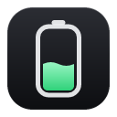
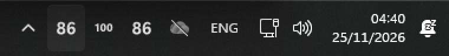
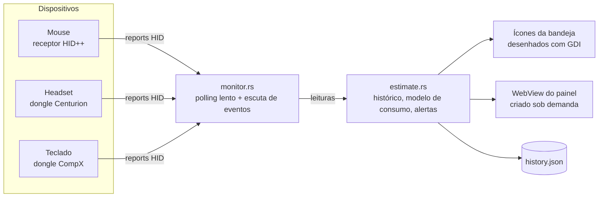

<div align="center">



# Pulso

**A bateria de todos os seus periféricos sem fio, a um olhar do relógio.**

Um painel de vidro para o Windows 11 que mostra carga, carregamento, tempo ligado e estimativa
real de uso do mouse, do teclado e do headset. Ele conversa direto com os dispositivos via HID,
sem precisar do app do fabricante aberto.

[](https://github.com/alanaraujo-bit/pulso/actions/workflows/ci.yml)
[](https://github.com/alanaraujo-bit/pulso/releases)
[](LICENSE)


[**Baixar**](https://github.com/alanaraujo-bit/pulso/releases/latest) ·
[Dispositivos](#dispositivos-suportados) ·
[Adicione o seu](docs/adicionar-dispositivo.md) ·
[Como contribuir](CONTRIBUTING.md) ·
[English](README.en.md)


</div>

## Por quê

A maioria dos widgets de bateria mostra só um número. O Pulso diz o que esse número significa:
**quantas horas de uso ainda restam do jeito que você realmente usa o dispositivo**, há quanto
tempo ele está ligado e quando foi a última carga. O consumo é medido contra o tempo em que o
dispositivo estava ativo de verdade, então um headset desligado a noite toda não bagunça a estimativa.

## Recursos


- **Porcentagem ao lado do relógio.** Um indicador por dispositivo, nítido em qualquer escala.
  Verde carregando, vermelho em 15% ou menos, apagado quando o dispositivo dorme.
- **Flyout de vidro.** Abre ancorado no ícone clicado, com o acrylic do próprio Windows.
  Fecha com <kbd>Esc</kbd> ou clicando fora.
- **Painel flutuante.** Destaque, arraste para onde quiser e deixe sempre visível se preferir.
- **Estimativas que aprendem.** Começam pela autonomia oficial do modelo e convergem para o seu
  consumo medido (passe o mouse em *Restante* para ver quanto já vem da medição).
- **Tempo até carga completa**, considerando a desaceleração do Li-ion acima de 85%.
- **Alertas** em 15%, 5% e quando a carga completa, uma vez por ciclo.
- **Levíssimo.** Em repouso é um único processo Rust com cerca de **3 MB de RAM e 0,1% de um
  núcleo**. O WebView do painel só existe enquanto você olha (abre em 300 ms a frio, 30 ms a
  quente) e é descartado após três minutos fechado.
- **Somente leitura.** O Pulso só pergunta bateria e nome. Nunca grava configuração no
  dispositivo e convive com o G HUB e outros apps de fabricante.
- **Tema claro e escuro**, seguindo o Windows.

<br clear="right">

<p align="center"></p>

## Dispositivos suportados

| Protocolo | Conexão | Testado com |
|---|---|---|
| Logitech **HID++ 2.0** (features `0x1004`, `0x1000`, `0x1001`) | Receptores LIGHTSPEED, Unifying e Bolt, cabo USB | PRO 2 LIGHTSPEED |
| Logitech **Centurion** (bridge `0x0003`, bateria `0x0104`) | Dongle de headset, usage page `0xFFA0` | PRO X 2 LIGHTSPEED |
| **CompX 2.4G** (report `0x13`, sessão + push) | Dongle `3554:FA09` | AULA F75 |

Outros aparelhos que falam esses protocolos provavelmente já funcionam (a maioria dos mouses e
teclados Logitech G, e outros teclados AULA, MCHOSE e Lingbao no mesmo dongle).

**O seu não está aqui?** Essa é a melhor forma de ajudar. Rode o probe, abra um
[pedido de dispositivo](https://github.com/alanaraujo-bit/pulso/issues/new?template=device-support.yml)
e cole a saída. O [guia](docs/adicionar-dispositivo.md) mostra como um protocolo novo é
adicionado, do começo ao fim.

## Instalação

1. Baixe o `Pulso_x.y.z_x64-setup.exe` na [última versão](https://github.com/alanaraujo-bit/pulso/releases/latest).
2. Execute. Instala por usuário, sem precisar de administrador.
3. Os dispositivos aparecem ao lado do relógio. Clique numa porcentagem para abrir o painel;
   botão direito para as opções.

O instalador ainda não é assinado, então o SmartScreen pode pedir confirmação
(*Mais informações → Executar assim mesmo*). Requer Windows 11 (o WebView2 já vem nele).

## Como funciona



- `monitor.rs` mantém os handles HID abertos, faz polling lento (30 s) e entre um e outro escuta
  os reports espontâneos: bateria enviada pelo próprio dispositivo, a notificação do receptor
  quando o mouse acorda, eventos de liga/desliga do headset. As mudanças aparecem na hora sem
  polling rápido.
- `estimate.rs` guarda amostras por dispositivo e mistura a autonomia oficial com o consumo
  observado nas últimas 24 horas ativas, ponderado por quanto já foi medido.
- "Ligado há" só aparece quando o Pulso viu o dispositivo ligar; antes disso o painel mostra
  "Ativo há" (desde que o Pulso o encontrou).
- A interface é HTML, CSS e JavaScript puros. Sem framework, sem bundler.

## Compilar do código

Requisitos: Rust (toolchain MSVC). Node.js só para gerar o instalador.

```powershell
cargo test --lib                 # parsers de protocolo e modelo de estimativa
cargo run --bin probe            # lê todos os dispositivos suportados e mostra o resultado
cargo run --bin probe -- --all   # também lista todas as coleções HID (para pedidos de dispositivo)
cargo run                        # o app em debug, imprime as leituras no console
npx @tauri-apps/cli@2 build      # release + instalador em target/release/bundle/nsis
```

O `dev/preview.html` renderiza o painel com dispositivos falsos num navegador comum
(`node dev/serve.mjs`), útil para mexer na interface sem hardware.

## Roadmap

Ideias abertas para qualquer pessoa pegar. A lista atual está nas
[issues](https://github.com/alanaraujo-bit/pulso/issues).

- Interface em inglês e traduções
- Dispositivos Bluetooth LE pelo GATT Battery Service padrão
- Protocolos Razer, SteelSeries, Corsair e HyperX
- Gráfico do histórico de bateria por dispositivo
- Instalador assinado e atualização automática

## Contribuindo

Relatos de bug, dados de dispositivos, protocolos novos e feedback de design são todos bem-vindos.
Issues e PRs podem ser em português ou inglês. Comece pelo [CONTRIBUTING.md](CONTRIBUTING.md)
ou chegue nas [Discussions](https://github.com/alanaraujo-bit/pulso/discussions) para perguntar
qualquer coisa.

## Créditos

Os formatos de protocolo foram aprendidos da documentação pública do
[HeadsetControl](https://github.com/Sapd/HeadsetControl) (Centurion) e do
[vigil-watt](https://github.com/evren-oct/vigil-watt) (dongles CompX). Nenhum código foi copiado.
O Pulso não tem vínculo com Logitech, AULA ou qualquer fabricante.

## Licença

[MIT](LICENSE)
