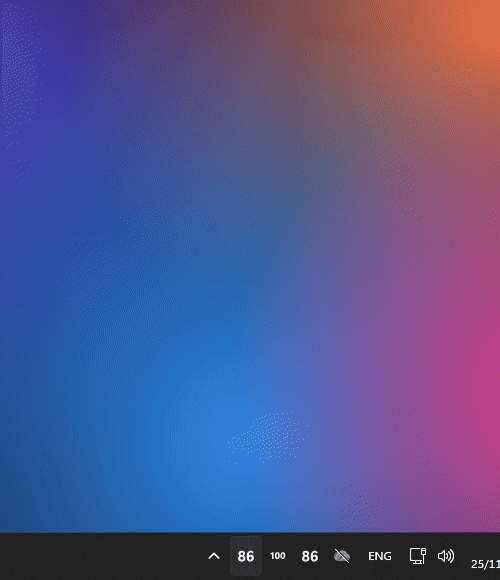
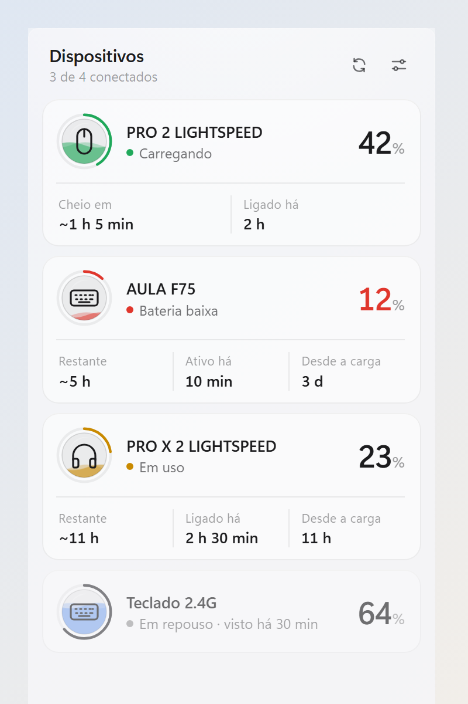
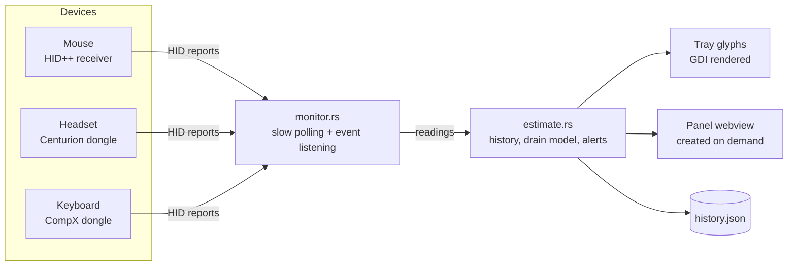

<div align="center">


# Pulso

**Battery for every wireless peripheral, one glance from the clock.**

A small liquid-glass panel for Windows 11 that shows charge, charging state, time on and
real usage estimates for your mouse, keyboard and headset. It talks to the devices directly
over HID, so no vendor app has to be running.

[](https://github.com/alanaraujo-bit/pulso/actions/workflows/ci.yml)
[](https://github.com/alanaraujo-bit/pulso/releases)
[](LICENSE)


[**Download**](https://github.com/alanaraujo-bit/pulso/releases/latest) ·
[Supported devices](#supported-devices) ·
[Add your device](docs/adding-a-device.md) ·
[Contributing](CONTRIBUTING.md) ·
[Português](README.pt-BR.md)



</div>

## Why

Most battery widgets show a number. Pulso also tells you what the number means:
**how many hours of use are left at the way you actually use the device**, how long it has
been on, and when it was last charged. It measures drain against the time the device was
really active, so a headset that sat switched off all night does not skew the estimate.

## Features



- **Percent next to the clock.** One tray glyph per device, crisp at any DPI. Green while
  charging, red at 15% and below, dimmed while the device sleeps.
- **Glass flyout.** Opens anchored to the icon you clicked, on real Windows acrylic.
  Closes with <kbd>Esc</kbd> or a click outside.
- **Floating panel.** Detach it, drag it anywhere, keep it on top if you like.
- **Estimates that learn.** Starts from the model's rated battery life, then converges to your
  measured drain (hover *Remaining* to see how much of it is measured).
- **Time to full** while charging, with the usual Li-ion slowdown above 85%.
- **Alerts** at 15%, 5% and when charging completes, once per cycle.
- **Featherweight.** At rest Pulso is a single Rust process using about **3 MB of RAM and
  0.1% of one core**. The panel's webview exists only while you look at it (300 ms cold open,
  30 ms warm) and is dropped after three minutes closed.
- **Read-only and coexistent.** Pulso only asks for battery and name. It never writes device
  settings and works alongside G HUB and other vendor apps.
- **Light and dark**, following Windows.

<br clear="right">

<p align="center"></p>

## Supported devices

| Protocol | Connection | Verified with |
|---|---|---|
| Logitech **HID++ 2.0** (features `0x1004`, `0x1000`, `0x1001`) | LIGHTSPEED, Unifying and Bolt receivers, USB cable | PRO 2 LIGHTSPEED |
| Logitech **Centurion** (bridge `0x0003`, battery `0x0104`) | Headset dongle, usage page `0xFFA0` | PRO X 2 LIGHTSPEED |
| **CompX 2.4G** (report `0x13`, session + push) | Dongle `3554:FA09` | AULA F75 |

Other devices that speak these protocols most likely work already (most Logitech G mice and
keyboards, more AULA, MCHOSE and Lingbao boards on the same dongle).

**Your device is not here?** That is the best way to help. Run the probe, open a
[device request](https://github.com/alanaraujo-bit/pulso/issues/new?template=device-support.yml)
and paste the output. The [guide](docs/adding-a-device.md) shows how a new protocol is added,
start to finish.

## Install

1. Download `Pulso_x.y.z_x64-setup.exe` from the [latest release](https://github.com/alanaraujo-bit/pulso/releases/latest).
2. Run it. It installs per user, no admin needed.
3. Your devices show up next to the clock. Click any percentage to open the panel;
   right-click for options.

The installer is not code-signed yet, so SmartScreen may ask for confirmation
(*More info → Run anyway*). Requires Windows 11 (WebView2 is built in).

## How it works



- `monitor.rs` keeps every HID handle open, polls slowly (30 s) and listens in between for
  unsolicited reports: battery broadcasts, the receiver's connect notification when a mouse
  wakes up, headset power events. Changes show up immediately without fast polling.
- `estimate.rs` records samples per device and blends the rated battery life with the drain
  observed over the last 24 active hours, weighted by how much has been measured.
- The UI is plain HTML, CSS and JavaScript. No framework, no bundler.

## Build from source

Requirements: Rust (MSVC toolchain). Node.js is only needed to produce the installer.

```powershell
cargo test --lib                 # protocol parsers and estimate model
cargo run --bin probe            # read every supported device and print what was found
cargo run --bin probe -- --all   # also list every HID collection (for device requests)
cargo run                        # the app, debug build, logs readings to the console
npx @tauri-apps/cli@2 build      # release build + installer in target/release/bundle/nsis
```

`dev/preview.html` renders the panel with mock devices in a normal browser
(`node dev/serve.mjs`), handy for UI work without hardware.

## Roadmap

Ideas that are open for anyone to pick up. Check the
[issues](https://github.com/alanaraujo-bit/pulso/issues) for the current list.

- English UI and translations (the panel is Portuguese today)
- Bluetooth LE devices through the standard GATT Battery Service
- Razer, SteelSeries, Corsair and HyperX protocols
- Battery history chart per device
- Signed installer and auto-update

## Contributing

Bug reports, device data, protocol work and design feedback are all welcome.
Read [CONTRIBUTING.md](CONTRIBUTING.md) to get set up, or jump into
[Discussions](https://github.com/alanaraujo-bit/pulso/discussions) to ask anything.

## Credits

Protocol layouts were learned from the public documentation of
[HeadsetControl](https://github.com/Sapd/HeadsetControl) (Centurion) and
[vigil-watt](https://github.com/evren-oct/vigil-watt) (CompX dongles). No code was copied.
Pulso is not affiliated with Logitech, AULA or any other manufacturer.

## License

[MIT](LICENSE)
